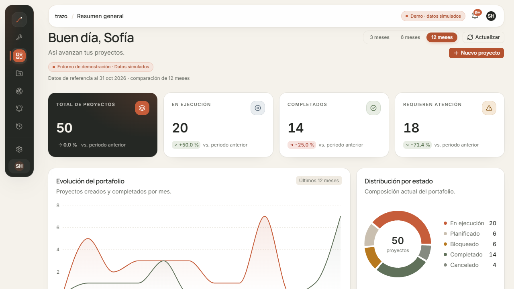
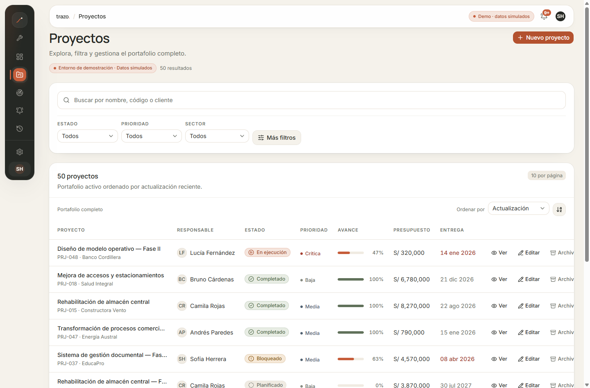
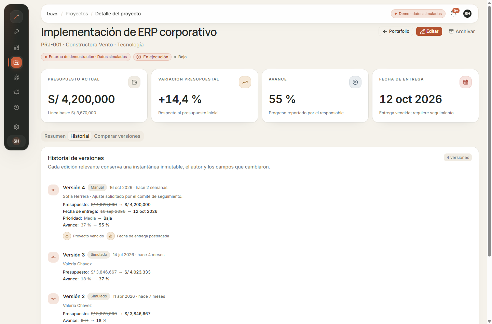
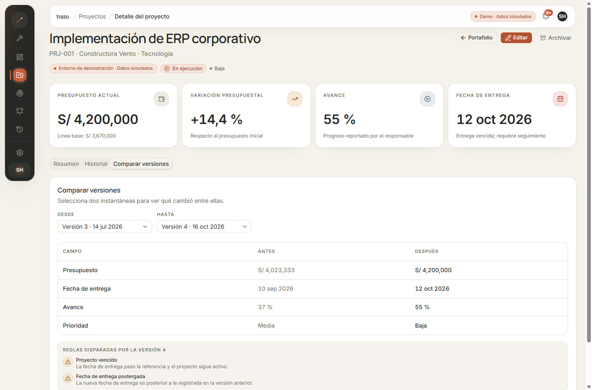
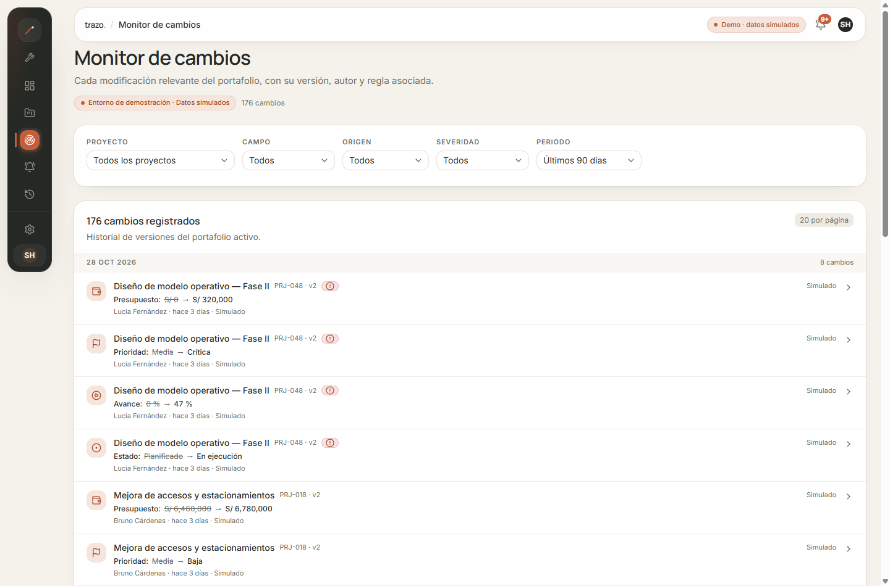
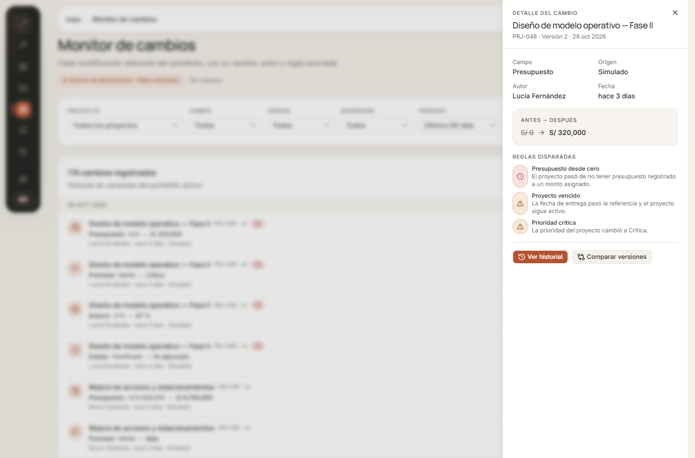
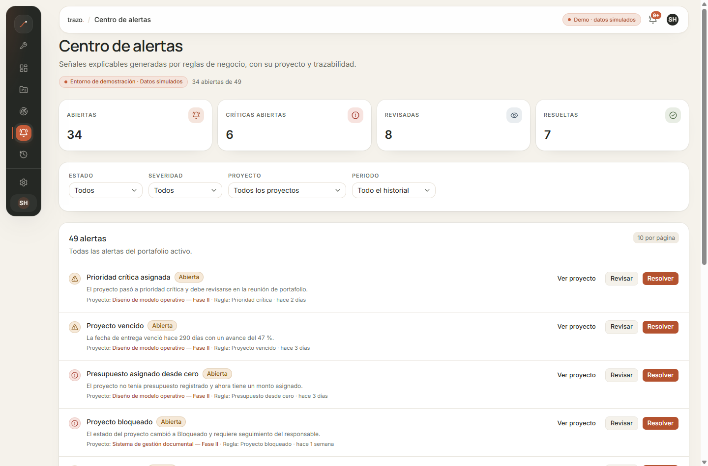
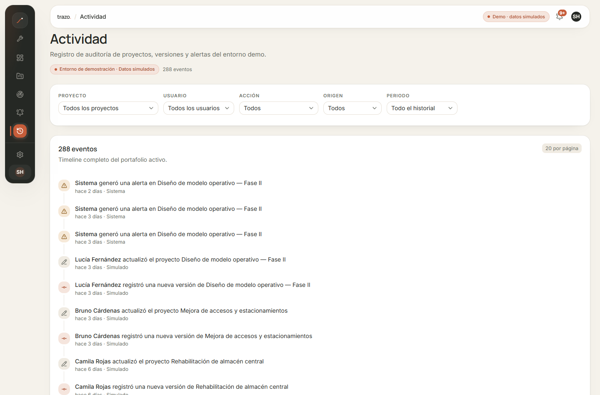
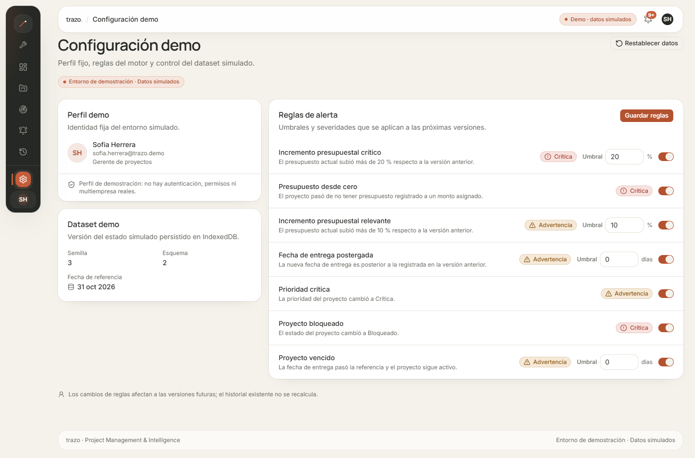
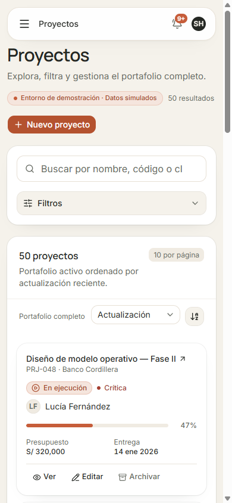

<h1 align="center">Trazo</h1>

<p align="center">
  <strong>Gestión inteligente de proyectos</strong><br />
  Cada proyecto tiene un camino.
</p>

<p align="center">
  <em>Project Management &amp; Intelligence · demo funcional con datos simulados</em>
</p>

---

Trazo es una plataforma SaaS de gestión y monitoreo inteligente de proyectos
empresariales, orientada inicialmente al mercado peruano y latinoamericano.
Centraliza portafolio, presupuestos, avances y alertas, y conserva el historial
de cada cambio para explicar qué se modificó, cuándo y por qué.

La demo usa **datos ficticios deterministas** y un reloj de referencia fijo, de
modo que el portafolio siempre se ve coherente sin depender de un backend.

> Repositorio: [`Dxexo10/trazo`](https://github.com/Dxexo10/trazo). La URL
> anterior de GitHub redirige automáticamente al nuevo nombre.

## Identidad

- **Paleta:** grafito `#252824`, terracota `#C65D3A`, marfil `#F5F2EB`,
  arena `#E7E0D5` y oliva `#60715A`.
- **Tipografía:** Manrope para encabezados e Inter para interfaz y cifras.
- **Layout:** Floating Workspace con sidebar compacta/expandible, superficie de
  topbar independiente y composición editorial.
- Guía completa: [`TRAZO_BRAND_GUIDELINES.md`](TRAZO_BRAND_GUIDELINES.md).

## Estado del proyecto

| Fase                                               | Alcance                                                                                                    | Estado         |
| -------------------------------------------------- | ---------------------------------------------------------------------------------------------------------- | -------------- |
| **F1 · Fundamentos + Dashboard + identidad Trazo** | Design system, layout responsive, dataset simulado, repositorios mock sobre IndexedDB, dashboard ejecutivo | **Disponible** |
| **F2 · Proyectos**                                 | Portafolio con filtros en URL, alta/edición, archivado y detalle                                           | **Disponible** |
| **F3 · Inteligencia de cambios**                   | Versiones inmutables, comparador antes/después, motor de reglas, centro de alertas, monitor e historial    | **Disponible** |
| **F4 · Pulido y QA**                               | Actividad, ajustes y reset demo, E2E con Playwright, CI y capturas                                         | **Disponible** |
| F5–F7 · Backend                                    | API REST con Node/Express, Prisma y PostgreSQL                                                             | Planificado    |

### Disponible hoy

- Dashboard ejecutivo (`/dashboard`) con saludo personalizado, KPIs calculados
  desde los datos, tres gráficos, tabla de proyectos que requieren atención y
  actividad reciente en formato timeline.
- Filtro de periodo (3 / 6 / 12 meses) reflejado en la URL: ajusta la serie
  mensual y la comparación contra el periodo anterior, mientras los totales
  siempre representan el portafolio activo completo.
- Navegación flotante con modo compacto de iconos, tooltips accesibles, estado
  activo terracota y preferencia persistida en el navegador.
- Layout responsive completo: rail compacto en desktop, drawer móvil con cierre
  por Escape y topbar flotante independiente.
- Portafolio `/projects` con búsqueda, filtros combinables de estado, prioridad,
  sector, responsable y riesgo, orden, paginación y estado de archivados.
- Vista de tabla en desktop y tarjetas en móvil, con acciones de ver, editar y
  archivar (con confirmación y archivado lógico).
- Formulario crear/editar con React Hook Form + Zod: información general,
  línea base vs. presupuesto actual, cronograma, avance y reglas de completado.
- Edición transaccional: cada cambio relevante crea una versión inmutable, un
  evento por campo modificado y las alertas que dispare el motor de reglas.
- Detalle `/projects/:id` con KPIs, alcance, presupuesto, alertas relacionadas,
  actividad reciente y pestañas de historial y comparación antes/después.
- Historial de versiones con autor, fecha, origen, motivo y campos cambiados;
  comparador entre dos versiones con las reglas que se dispararon.
- Monitor `/monitor` con feed agrupado por fecha, filtros por proyecto, campo,
  origen, severidad y periodo, detalle del cambio y enlaces al proyecto.
- Centro de alertas `/alerts` con contadores, filtros, la regla que originó cada
  alerta y acciones para revisar o resolver con trazabilidad.
- Actividad `/activity`: timeline de auditoría con filtros por proyecto, usuario,
  acción, origen y periodo, más paginación.
- Configuración `/settings`: perfil demo, umbrales de reglas editables, versión
  del dataset y reset con confirmación.
- Dataset determinista de 50 proyectos, versiones, cambios, alertas, actividad y
  reglas persistidos en IndexedDB (sobreviven a la recarga).
- Suite E2E con Playwright del flujo estrella y workflow de CI con lint,
  typecheck, pruebas, build y E2E.
- Estados de carga, error y vacío; navegación por teclado y foco visible.

## Stack

- **React 19 + Vite + TypeScript** (modo estricto)
- **Tailwind CSS v4** con tokens de diseño propios
- **shadcn/ui** sobre Base UI + **Lucide React**
- **Manrope + Inter** autohospedadas con `@fontsource-variable`
- **React Router 7**, **TanStack Query 5**, **Recharts**
- **React Hook Form + Zod** (base de formularios de la Fase 2)
- **idb** para persistencia local
- **Vitest + React Testing Library** · **ESLint + Prettier**
- _Planificado:_ TanStack Table, Playwright, Node.js + Express, Prisma, PostgreSQL

## Cómo ejecutar

Requisitos: Node.js ≥ 20.19 y npm ≥ 10.

```bash
cd frontend
npm install
npm run dev        # http://localhost:5173
```

Scripts disponibles:

```bash
npm run dev            # servidor de desarrollo
npm run build          # compilación de producción
npm run preview        # sirve el build
npm run typecheck      # TypeScript sin emitir
npm run lint           # ESLint
npm run format         # Prettier
npm run test           # Vitest
```

> Si tu entorno define `NODE_ENV=production`, instala con
> `npm install --include=dev` para incluir las dependencias de desarrollo, y
> ejecuta las pruebas con `NODE_ENV=test npm run test`.

## Arquitectura

```text
UI (features + components)
        ↓
Hooks / casos de uso (TanStack Query)
        ↓
Contratos de repositorio (src/data/contracts)
        ↓
Adaptador mock + IndexedDB  ← Fase 1
        ↓
Adaptador HTTP + API REST   ← Fase 5 (misma interfaz)
```

La UI nunca importa fixtures directamente. Para conectar el backend real solo se
sustituyen las instancias exportadas en `src/data/index.ts`; vistas y servicios
de dominio no cambian. Detalle completo en
[`docs/ARCHITECTURE.md`](docs/ARCHITECTURE.md).

## Datos simulados

- Semilla fija `20261031`, generador propio (mulberry32) y fecha de referencia
  `2026-10-31`, documentados en [`docs/DECISIONS.md`](docs/DECISIONS.md).
- 50 proyectos de tecnología, construcción y consultoría, 10 responsables
  ficticios, alertas y actividad derivadas del mismo estado.
- Persistencia local en la base IndexedDB `trazo-demo`; la resiembra se fuerza
  con `seedVersion`.
- Dinero como enteros en céntimos; fechas en ISO-8601 UTC.
- La etiqueta **“Entorno de demostración · Datos simulados”** es visible en toda
  la aplicación.

## Pruebas y calidad

```bash
npm run lint && npm run typecheck && NODE_ENV=test npm run test && npm run build
```

Cobertura actual: utilidades de dinero y fechas, agregación de KPIs, determinismo
del dataset, repositorios sobre IndexedDB, diff de versiones, motor de reglas y
alertas, feed de cambios, dashboard, filtros de portafolio, validación del
formulario, historial/comparador, monitor, alertas, actividad, configuración y
navegación. La suite E2E cubre el flujo estrella completo con Playwright.

## Capturas

Capturas reales de la aplicación en ejecución con el dataset ficticio del demo.

| Dashboard                                              | Proyectos                                                |
| ------------------------------------------------------ | -------------------------------------------------------- |
|  |  |

| Historial de versiones                                          | Comparador antes/después                                            |
| --------------------------------------------------------------- | ------------------------------------------------------------------- |
|  |  |

| Monitor de cambios                                  | Detalle de un cambio                                       |
| --------------------------------------------------- | ---------------------------------------------------------- |
|  |  |

| Centro de alertas                                 | Actividad                                               |
| ------------------------------------------------- | ------------------------------------------------------- |
|  |  |

| Configuración                                        | Móvil                                                        |
| ---------------------------------------------------- | ------------------------------------------------------------ |
|  |  |

## Limitaciones conocidas

- No hay backend, autenticación ni multiempresa: el perfil es fijo y de demo.
- La auditoría formal de accesibilidad AA y los escenarios de simulación de
  actualizaciones siguen pendientes; la E2E cubre el flujo estrella.
- Las capturas se tomaron en 1440 px; la interfaz también se verificó en 768 y
  390 px.
- El periodo del dashboard afecta a la tendencia y a los deltas frente al
  periodo anterior; los totales y la distribución representan el portafolio
  activo completo.

## Licencia

[MIT](LICENSE) · Proyecto personal de demostración. Los nombres de clientes,
personas y montos son ficticios.
